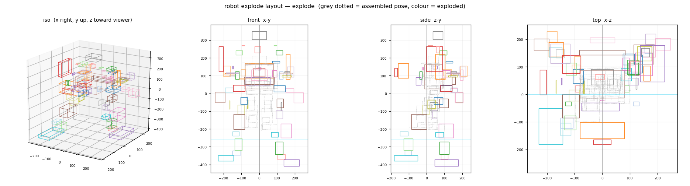

# robot-tear-down · 双足机器人三维拆解台

把一台 **55 个零件**的双足人形机器人装配体（SolidWorks 装配体，整机 **205.6 × 420.2 × 198.7 mm**）做成**单文件、完全离线**的网页拆机台：直接打开 `index.html`，就能把零件一件件拖出来、拖回去。

> **在线看**：推上去之后，仓库 `Settings → Pages → Source` 选 `main` / `(root)`，等一两分钟访问
> `https://keepgoinglong.github.io/robot-tear-down/`



*上图是排布自检图：灰虚线是装配状态、彩色是拆解状态（前视 / 侧视 / 俯视 / 立体）。*

## 功能

**拆解交互**

- 55 个零件全部可拖拽：拖出一半松手，按行程自动判定「拆下」还是「装回」
- 拖拽时零件沿自己的爆炸轴移动，松开后被阻尼平滑接管
- 逐步拆解 `N` / 回退一步 `B`、撤销 `Ctrl+Z`、拆解度滑块、全部拆解 `E`、全部回装 `R`
- **回到装配态 `0`**：瞬时回到未拆解状态——零件全部归位、清空自由摆放、清空撤销历史、取消选中、相机回初始视角

**视角**

- 自研轨道控制器（没有用 OrbitControls）：临界阻尼跟随、甩动惯性、缩放朝向光标、视角补间
- 全程**相机不自动移动**：逐步拆解不会把镜头拉向零件，只有你主动双击零件、或点详情面板的「拆解点」/「对焦视角」才会动
- `1`–`7` 标准视角、`V` 回初始视角、`S` 自动旋转、`X`/`Y`/`Z` 翻转模型朝向（应对 CAD 原始朝向不同）

**画面**

- 深色工业拆机风：程序化生成的拉丝金属 / 皮革纹 / PCB / 电池 / 屏幕材质，PMREM 程序化环境光，全息地面网格 + 阴影
- 零件名称标签 `L`（全部展开时自动避让、按索引稳定排序，不闪不叠）、三维尺寸标注 `D`
- 拆解时**地板跟着最低零件一起下移**，零件永远不会沉到网格下面

## 爆炸排布（这个页面的核心）

所有零件沿「**整机中心 → 零件自身**」的射线向外炸开，因此左右自动镜像、整机像被从中心撑大：

1. 方向 `dir = normalize(center → 零件)`（垂直分量压扁 0.66，让爆开范围宽大于高）
2. 距离 `dist ≈ 12 + 0.58 · r`，上限 170 mm（`r` 是该零件到整机中心的距离）→ 整体约放大到 2.2 倍
3. **同射线且相邻的零件做保序一维堆叠**：只补足「还差多少才不重叠」，而不是每件再加一个自身全长——否则腿会被拉成两倍长
4. 下半身（腿/脚）的射线再往两侧摊开，脚不会直插到地板下面
5. 做**只向外的去穿插松弛**：任何重叠都靠把「更靠外」的那件继续往外推来消除。这个方向很关键——推「更靠内」的那件会让它反超相邻件（早期版本就是这样把底部连接支架挤到脚底板下面的）
6. 例外：**外壳2 钉住不动**，其余零件从它里面取出来；电池 / K230D / 前盖板 强制朝正后方（−Z）退出

校验：55 件两两包围盒**零互穿**，整机中心基本在原点，爆开后包围盒 495 × 756 × 410 mm。

## 数据管线

```
机器人.SLDASM / STEP ──01_step_split──▶ 装配层级 + 55 个中文零件名 + 4×4 变换
机器人.3mf ──────────03_pack_3mf───▶ 量化几何(33 种) + 实例矩阵 + 包围盒
                                     │
                   04_emit_data ─────┴──▶ 页面数据 ROBOT_META（居中 + 爆炸向量 ex/exd）
                                     │
                   06_explode_layout ─┘   径向排布 + 保序堆叠 + 去穿插
                                     │
                   07/08_patch ──────┴──▶ 打进页面：标签规则 / 地板跟随
```

**为什么几何走 3MF 而不是 STEP**：`occt-import-js`（OpenCASCADE 的 wasm）读这份 115 MB 的 STEP 会撞上 wasm 的 2 GB 堆上限，进程被内核 SIGKILL；而 3MF 只用 Python 标准库（`zipfile` + 正则）30 秒就能解完，**不需要任何 CAD 库**。装配树和中文零件名反而只在 STEP 里有，所以两边各取所需。

脚本逐个说明见 [`tools/README.md`](tools/README.md)。

## 目录

```
index.html                     成品页面（3.6 MB，离线单文件）
docs/explode-layout.png        爆炸排布自检图
tools/                         CAD → 网页 的完整管线（Python，无第三方依赖）
```

## 第三方

页面内联了 [three.js](https://threejs.org) r128（MIT）与 [pako](https://github.com/nodeca/pako)（MIT）。其余代码与材质贴图全部是程序化生成 / 自己写的，没有外部请求。

## 已知限制

- **CAD 源文件未包含**（SLDASM / STEP / 3MF 属于设计资料）；`tools/` 是可复用的管线，换一个装配体也能跑
- 55 件里有 6 件名称待确认，暂显示为「形状 + 尺寸」的描述名（如 `盘/环件 36×31×4`）
- 拆解顺序按零件类别 + 体积推断，不是真实装配工艺顺序
- 模型默认朝向取自 CAD 原始坐标系，若与你习惯的朝向不同，按 `X`/`Y`/`Z` 翻转即可